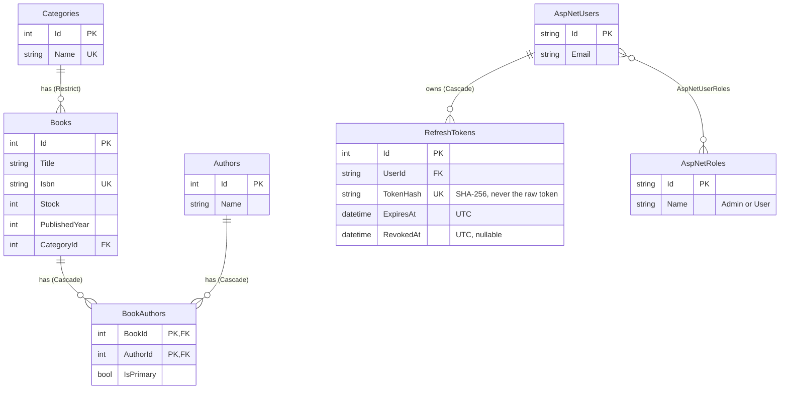

# LibraryApi

LibraryApi is a REST WebAPI for managing a library's book data, built with C# (.NET 8), EF Core (SQLite) and ASP.NET Core Identity with JWT authentication. It is the upgrade of the LibraryApp console application and demonstrates CRUD for Category, Author and Book using Fluent API, FluentValidation, the Repository pattern, DTOs with AutoMapper, and the `ServiceResult<T>` pattern.

## Running the app

Requirements: .NET 8 SDK (`global.json` pins 8.0.x) and, for migrations only, `dotnet tool install --global dotnet-ef --version 8.*`.

1. Create the local secrets file from the template (`.env` is git-ignored):

   ```bash
   cp .env.example .env          # PowerShell: Copy-Item .env.example .env
   ```

2. Fill in `.env`:

   | Key | Meaning |
   | --- | ------- |
   | `Jwt__Key` | JWT signing key, **at least 32 characters** (e.g. `openssl rand -base64 48`). The app refuses to start without it. |
   | `Seed__AdminPassword` | Password of the seeded `admin@gmail.com` user. Only read in the `Development` environment, and it must satisfy the password rules (6+ characters, a digit, an upper and a lower case letter). |

   A real environment variable with the same name (`Jwt__Key`) wins over `.env`. Never put these values in `appsettings*.json`.

3. Run:

   ```bash
   dotnet run
   ```

   On startup the app applies the migrations, seeds the roles `Admin` and `User`, the sample data (2 categories, 3 authors, 2 books) and, in Development only, the admin user. Swagger UI opens at `https://localhost:7028/swagger` (or `http://localhost:5105/swagger`). To start over, delete `library.db` and run again.

4. In Swagger: call `POST /api/auth/login`, paste the `accessToken` into the **Authorize** button, then call the other endpoints. Use `admin@gmail.com` to test write operations.

Token lifetimes are `TimeSpan` values in `appsettings.json`: `Jwt:AccessTokenLifetime` (`00:15:00`) and `Jwt:RefreshTokenLifetime` (`7.00:00:00`).

## Endpoints

| Method | Route | Role | Success |
| ------ | ----- | ---- | ------- |
| POST | `/api/auth/register` | anonymous (new user gets role `User`) | 201 |
| POST | `/api/auth/login` | anonymous | 200 |
| POST | `/api/auth/refresh` | anonymous (body: refresh token) | 200 |
| POST | `/api/auth/logout` | anonymous (body: refresh token) | 200 |
| GET | `/api/categories`, `/api/categories/{id}` | any logged-in user | 200 |
| POST, PUT, DELETE | `/api/categories`, `/api/categories/{id}` | `Admin` | 201, 200, 204 |
| GET | `/api/authors`, `/api/authors/{id}` | any logged-in user | 200 |
| POST, PUT, DELETE | `/api/authors`, `/api/authors/{id}` | `Admin` | 201, 200, 204 |
| GET | `/api/books`, `/api/books?title=...`, `/api/books/{id}` | any logged-in user | 200 |
| POST, PUT, DELETE | `/api/books`, `/api/books/{id}` | `Admin` | 201, 200, 204 |

A book request carries `title`, `isbn`, `stock`, `publishedYear`, `categoryId`, `authorIds` and `primaryAuthorId` (exactly one primary author, who must be in `authorIds`).

### Response envelope

Every response body, including 401 and 403, has the same shape:

```json
{ "isSuccess": false, "data": null, "message": "Data yang dikirim tidak valid.", "errors": { "Stock": ["..."] } }
```

| Status | When |
| ------ | ---- |
| 400 | Invalid input (`errors` lists messages per field) or an empty/malformed body |
| 401 | No, invalid or expired access token; wrong credentials; unknown, expired or revoked refresh token |
| 403 | Logged in but not `Admin` on a write endpoint |
| 404 | The id in the URL does not exist |
| 409 | Duplicate ISBN, category name or email; deleting a category or author that is still used by a book |

## Data model



The `AspNet*` tables come from `IdentityDbContext<ApplicationUser>`; only the ones relevant to this API are drawn.

## Where each pattern lives

| Pattern | Location |
| ------- | -------- |
| Fluent API | `Data/Configurations/*Configuration.cs` (`IEntityTypeConfiguration<T>`, one per entity), applied in `Data/AppDbContext.cs` |
| FluentValidation | `Validators/` (one validator per request DTO), called at the start of each method in `Services/`; registered with `AddValidatorsFromAssemblyContaining` in `Program.cs` |
| Repository | `Repositories/` (`IRepository<T>` / `Repository<T>` plus `IBookRepository`, `ICategoryRepository`, `IAuthorRepository`, `IRefreshTokenRepository`) |
| DTO + AutoMapper | `DTOs/` (records per feature), `Mappings/MappingProfile.cs`; entities never leave `Services/` |
| JWT + Identity | `Models/ApplicationUser.cs`, `Data/AppDbContext.cs`, `Common/JwtOptions.cs`, `Services/JwtTokenGenerator.cs`, `Services/AuthService.cs`, `Controllers/AuthController.cs`, `AddIdentityCore` and `AddJwtBearer` in `Program.cs` |
| Refresh token | `Models/RefreshToken.cs`, `Services/RefreshTokenService.cs` (random token, SHA-256 hash stored, rotation on refresh, revoke on logout) |
| RBAC | `Common/RoleNames.cs`, role seeding in `Data/DbSeeder.cs`, `[Authorize(Roles = RoleNames.Admin)]` on the write actions in `Controllers/` |
| ServiceResult\<T\> | `Common/ServiceResult.cs`, `Common/ErrorType.cs`; mapped to HTTP in `Controllers/ApiControllerBase.cs` (`ToActionResult`) and `Common/ApiJwtBearerEvents.cs` (401/403) |

Layering: `Controller → Service → Repository → DbContext`. Controllers only translate HTTP, Services hold the business rules and know nothing about HTTP, and only Repositories (and `DbSeeder`) touch `AppDbContext`.
